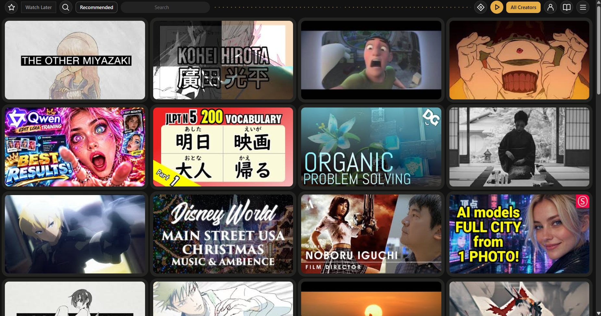
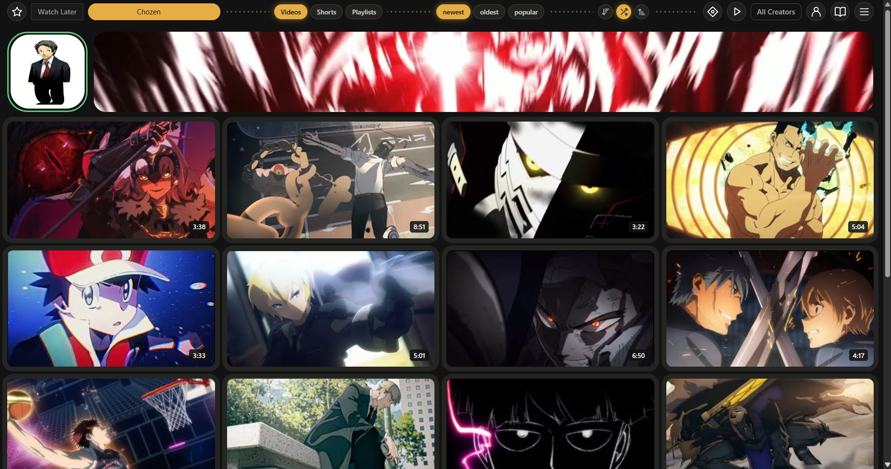
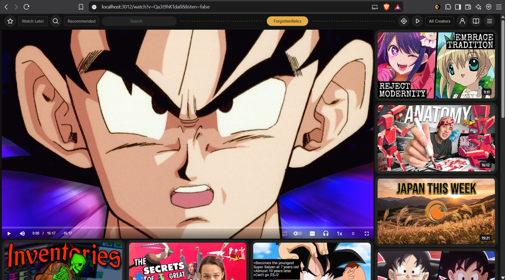

# Individuous

A local, single-user Invidious fork with a compact video wall, search groups,
collections, creator feeds, hidden videos and hover playback.

This is the consolidated release source. Its default address is
**http://localhost:3012/star.html**. Installed and development profiles use this
same source with separate private configuration and data volumes.

## Screenshots

A compact wall for browsing videos from your creators:



Creator pages keep content tabs, sorting and feed-order controls above the videos:



The watch page keeps the main player beside a wall of related videos:



Hover the page body and press **S** to shuffle the loaded videos on creator pages
or the related videos on watch pages. The main player stays in place.

## Start a fresh installation

Install Docker Desktop with Linux containers. On Windows, run **Start.cmd**.
It generates fresh random configuration with `Setup.ps1`, then builds and starts
the project. The first source build compiles Invidious and OpenSSL and can take
several minutes. Subsequent interface builds reuse those layers.

From PowerShell:

```powershell
./Setup.ps1
docker compose up -d --build
```

One local account is created automatically in the new database. No YouTube login
is needed for local collections, search groups or creator follows. New accounts
start without personal follows, search terms, history or imported sessions.

Empty Playlists, Search Groups, History, Hidden videos, Following,
Search terms, personal YouTube feed and zero-result searches show contextual
first steps with distinct transparent character poses and amber framed hotkeys.
The creator-group tutorial appears only on the empty Following manager; its video
feed shows loading/empty status and keeps the tutorial on the manager page.
Menu has no character; its inline shortcuts use the same amber caps and explain
Ctrl-click on the main video area opens YouTube. Guidance disappears when content
appears. Artwork and prompts are documented in [TUTORIAL_ARTWORK.txt](TUTORIAL_ARTWORK.txt)
and [TUTORIAL_ARTWORK_ADDITIONAL.txt](TUTORIAL_ARTWORK_ADDITIONAL.txt).

The default Compose project is `individuous`. For an independent development
copy, set `COMPOSE_PROJECT_NAME=individuous-preview` and `INDIVIDUOUS_PORT=3013`
in its `.env`; its images, containers and volumes stay separate. Keep a consistent
hostname and port for browser storage. Existing installations can specify their
volume names with the `INDIVIDUOUS_*_VOLUME` overrides documented in RELEASE_NOTES.md.

```powershell
docker compose logs --tail=80
docker compose stop
docker compose start
```

Use `up -d --build` again after source changes. Stop preserves data. Removing
Compose volumes with `down -v` deletes the preview's data.

## Protected combined views

Favorites and Search each offer **All Groups**. Favorites combines saved videos
from every playlist, showing each video once. Search combines all groups' terms,
counting shared terms once. Both options are computed views and cannot be renamed
or deleted. Choose a named playlist to save, move, remove or shuffle its videos;
choose a named search group to add or edit terms. The combined contents are rebuilt
from their source groups and are never saved as duplicate collections.

Play and Following offer **All Creators**, which includes everyone you follow,
even creators assigned to no custom group. The previous All following ID is kept;
its display name migrates without changing follows or group membership.

## Following groups

The play button sits at the top right beside Following. Its group-name rectangle
chooses whose videos appear. **All Creators** always contains everyone you follow;
custom groups contain the creators you choose, and creators can belong to several.
The playlist selected on the left still controls where you save videos.

- **A** over the group name or in its open list: create a following group.
- **R** on a custom group in the list: rename; Enter saves, Esc cancels.
- **X twice** on a custom group in the list: delete the group, preserving follows.
- **I** over the group name: choose its creators with checkboxes and Save.
- **G** over a creator on Following (or their Groups button): edit all their memberships.
- **X twice** over a creator in a named group: remove that membership only.
  In All Creators, the existing two-press unfollow behavior remains.

Arrow keys and Enter select groups; Escape closes/cancels. In membership dialogs,
Tab moves and Space toggles a checkbox. I over the person icon still edits the
whole account follow list. All Creators cannot be renamed or deleted.

Groups are metadata in `pt-following-groups-v1`, synced to the isolated app-data
service alongside playlists. They do not create YouTube subscriptions. Feed URLs
include the group ID; restored walls also check group membership before reusing
cached videos. Missing groups and unreadable group data produce an error without
resetting the stored data. Older installations need no follow migration.

## Downloads and transcripts

On a video tile or the main player:

- **Click the red strip:** copy the YouTube video URL and open
  [YTUltra](https://www.ytultra.com/en/youtube-video-downloader/). Paste into its
  input. If clipboard access is blocked, Individuous shows the selectable URL.
- **Ctrl-click the red strip** (Command-click on Mac): open
  [YouTube Transcript](https://www.youtube-transcript.io/) with that video's ID.

Menu → Downloads & transcripts lets you change these destinations. URL templates
may contain `{id}` for the video ID or `{url}` for the encoded full YouTube URL.
A plain downloader URL uses the clipboard handoff. YTUltra did not prefill its
input in the tested `?url=` navigation; the app does not promise automatic filling.

These actions open external sites. Individuous does not download media, run
FFmpeg, extract transcripts or send your local YouTube session to those tools.
Playback and hover previews still stream media through Invidious and its companion.
External provider availability, sign-in requirements and results can change.

## Optional YouTube connection

Menu → YouTube connection can import your own YouTube session for the personal
home feed. A fresh preview has no saved connection. Connecting is optional and
separate from the automatically created local account. Treat the cookie as a
credential; enter it only into your own local app. It is saved in the private
`individuous_youtubeaccount` volume, excluded from app-data exports.
See [the service notes](youtube-account/README.md).

## Data and local hosting

Menu includes **Save hash / Load hash** and **Export info / Import info /
Clear everything**. Save hash downloads a separate private credential file;
ordinary info exports exclude that login. Loading a saved hash works offline,
then the Menu checks authentication. A saved file cannot extend an expired session.

Info exports include collections, groups, follows, watch history, account
preferences, native playlists, volume/crop settings and browser playback positions.
Import replaces app information after confirmation and retains the current hash.
Clear everything requires typing `CLEAR EVERYTHING`, removes app information,
saved hash and automatic app backups, and returns to empty defaults. Downloaded
media files remain. The automatic local sign-in account remains available.

Imports and resets reject stale writes, including native account actions.
Collection conflicts pause saving and let you download your unsaved copy and
choose the saved or local version. Menu → Recover saved data offers automatic
copies if the store is damaged. Interrupted import/reset operations resume from
durable intent before further reads or writes are accepted.

The default volumes are `individuous_postgresdata` (account, follows and
history), `individuous_appdata` (collections and search groups),
`individuous_companioncache` and `individuous_youtubeaccount`.
Back them up while the preview is stopped. Never publish `.env` or volume contents.
The app-data service also keeps daily and first-sync backups.

This is a local single-user app with automatic sign-in. Its port is bound to
127.0.0.1; do not expose it publicly. To choose another local port, change
`INDIVIDUOUS_PORT` in `.env` before starting. Do not use the installed app's port.

## Source and development

The complete upstream source and Git history are retained at Invidious revision
`48c6110a83fc788b4199daf737279b71950cc0db` (v2.20260804.1), the revision identified
in the installed image's labels. The old installation's `UPSTREAM.txt` named a
different revision; it was not used as the source baseline.

For Git clones, first run `git submodule update --init mocks` to fetch pinned
upstream test fixtures. Source archives include those fixtures.

`Dockerfile` compiles the local source using the upstream build, then integrates
the custom assets in `ui/` in their required order. `app-data.js` hydrates saved
data before interface scripts read it. `docker/Dockerfile` retains the upstream
build for reference. The companion image is pinned to its inspected digest.

`SOURCE_MANIFEST.json` records the original UI input hashes before preview changes.
The `upstream` Git remote points to iv-org/invidious. The `origin` publishing
remote is [dmitryalexander/individuous](https://github.com/dmitryalexander/individuous).

```powershell
node --test tests/*.test.cjs
docker build -t individuous-data-test appdata
docker run --rm --network none -v "${PWD}:/repo:ro" -w /repo individuous-data-test python -m unittest discover -s tests -p "test_*.py"
powershell -NoProfile -ExecutionPolicy Bypass -File tests/setup.test.ps1
docker compose run --rm --no-deps youtube-account npm test
```

See [release verification](RELEASE_NOTES.md) for current checks.
[Preview verification](PREVIEW_STATUS.md) preserves the earlier baseline.
The historical upstream README is [retained separately](README.upstream.md).

## Credits

Based on [Invidious](https://github.com/iv-org/invidious), under the
[GNU AGPL v3 license](LICENSE). The optional account service uses YouTube.js 18.1.0
(MIT); dependencies and integrity hashes are locked in its package lockfile.
The custom interface includes adaptations from [Pinless](https://github.com/bunk-im/pinless)
(AGPL v3). Preserve the upstream license and notices when redistributing.
Individuous is not affiliated with YouTube or the external tool providers.

Automatic daily copies keep the latest 14 days. First-sync copies keep at most
20 files, 128 MiB total, and 30 days of history (always retaining the newest copy).
These are recovery aids; use Export info and Save hash for your own backups.
